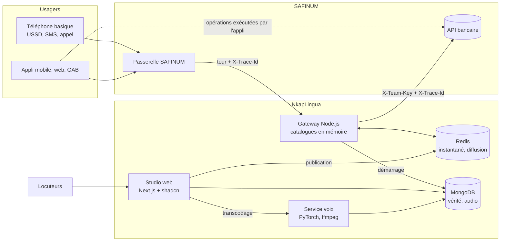
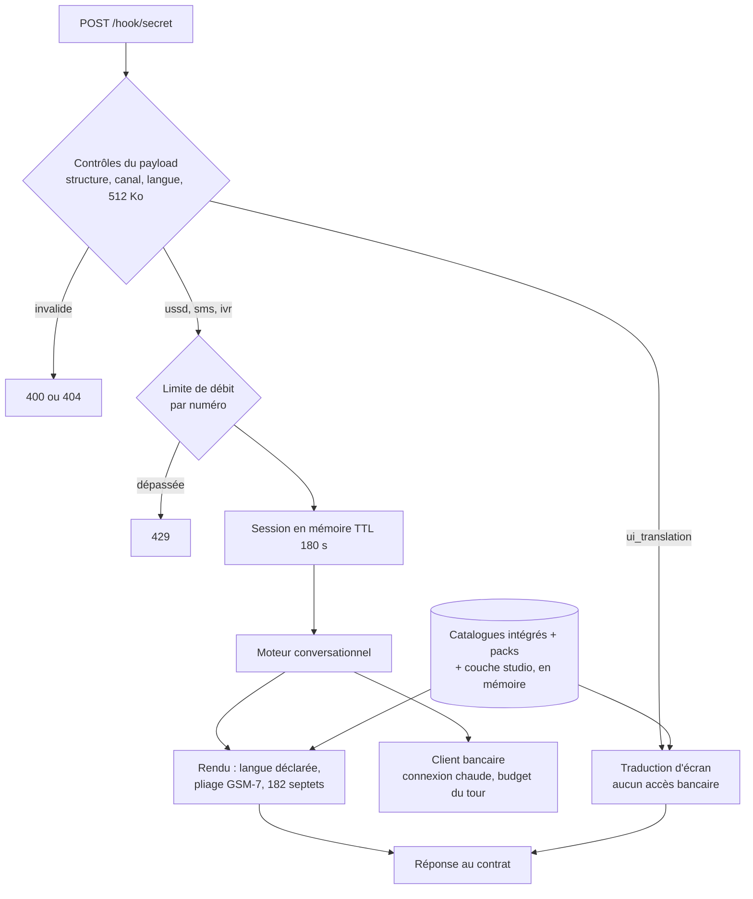
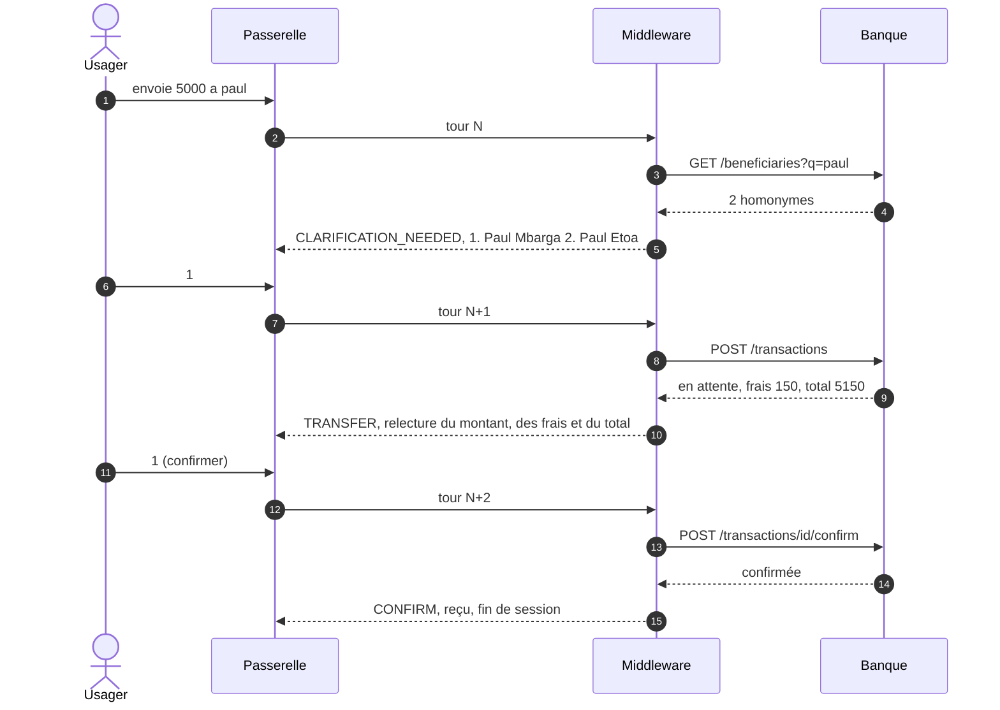
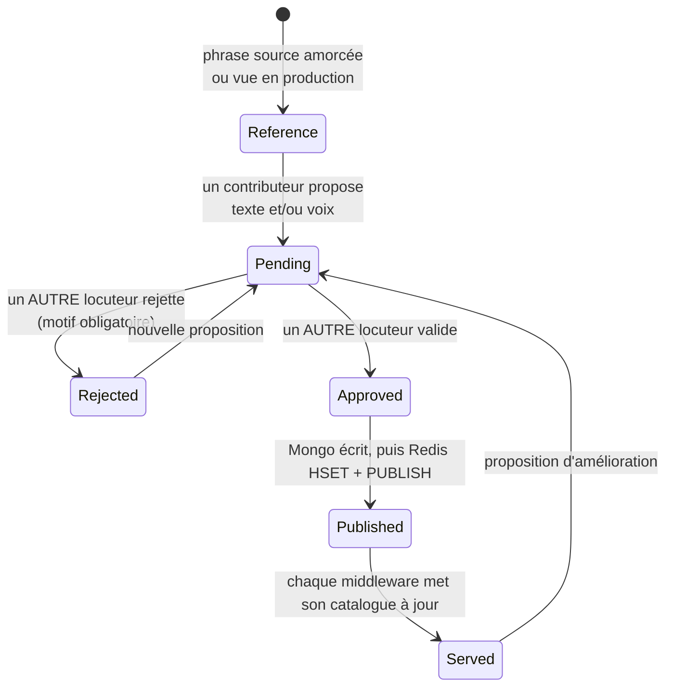
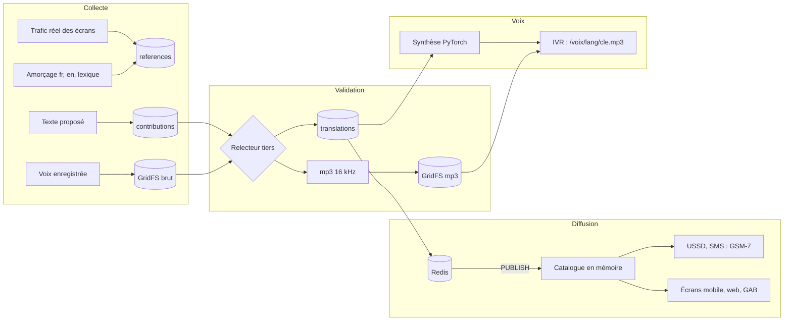
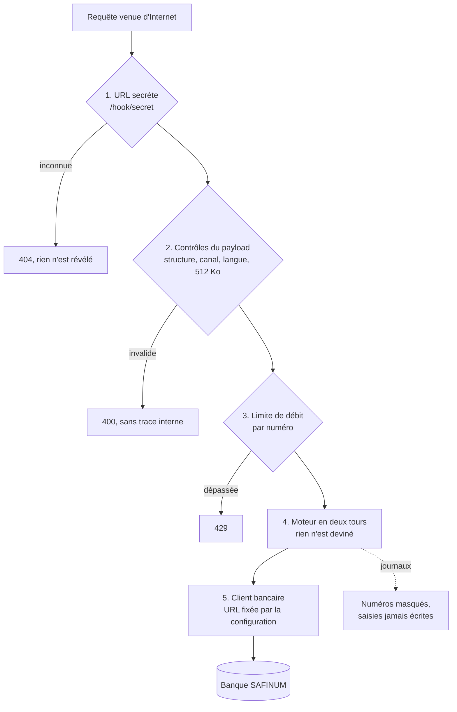
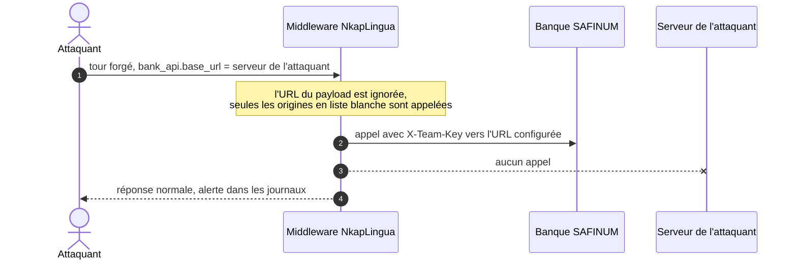
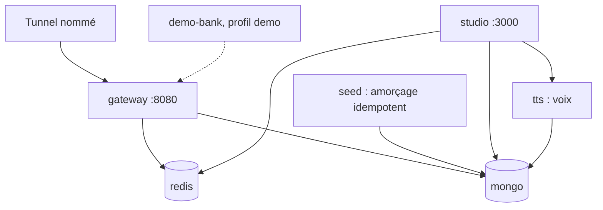

# NkapLingua : architecture technique

> Tout le monde devrait pouvoir parler le langage de l'argent.

Une réalisation **Shun&Co.** pour le SAFINUM Innovate Challenge 2026.

NkapLingua fait parler les services financiers dans les langues du Cameroun, sur six canaux : USSD, SMS, serveur vocal (IVR), application mobile, web et guichet automatique (GAB). Les locuteurs enrichissent les langues depuis un studio web, où chaque phrase est validée par un second locuteur avant d'être servie.

Stack : Node.js 22 (serveur HTTP natif, TypeScript strict), MongoDB 7, Redis 7, PyTorch (MMS-VITS), Next.js 15 et shadcn/ui. Livré en conteneurs Docker.

## 1. Vue d'ensemble



| Composant | Technologie | Rôle |
| --- | --- | --- |
| Gateway | Node.js 22, serveur HTTP natif, TypeScript strict | contrat SAFINUM, conversation, appels bancaires |
| Vérité | MongoDB 7, GridFS | références, propositions, base définitive, audio |
| Diffusion | Redis 7 | instantané des traductions validées, pub/sub |
| Voix | PyTorch, MMS-VITS, ffmpeg | synthèse des phrases fixes, transcodage mp3 |
| Studio | Next.js 15, shadcn/ui | contribution texte ou voix, relecture à quatre yeux |

Deux familles de canaux :

| Canaux | Ce que reçoit le middleware | Appels bancaires |
| --- | --- | --- |
| mobile, web, GAB | des gabarits (`{amount}`, `{name}`), jamais une valeur | aucun : l'appli opère elle-même |
| USSD, SMS, IVR | la saisie de l'usager, imposée par le contrat | oui, à chaque étape |

## 2. Le gateway



Fonctionnalités clés :

- **Traductions en mémoire, studio prioritaire.** Un écran de 40 clés est traduit en 24 µs, sans aller-retour réseau. Une phrase validée dans le studio l'emporte, phrase par phrase, sur les dictionnaires intégrés et les packs ; Redis amorce et met à jour cette couche, il n'est pas interrogé pendant un tour.
- **Connexion bancaire toujours chaude.** Keep-alive de 60 s et ping de maintien toutes les 20 s : quand l'usager a fini de lire et de taper, l'appel suivant ne coûte qu'un aller-retour réseau.
- **Délai borné.** Chaque appel bancaire est limité à 2,2 s pour tenir les 3 s d'un tour USSD ; une banque injoignable déclenche un menu hors ligne honnête.
- **Sessions.** En mémoire, 180 s, effacées en fin d'opération ; elles ne contiennent que l'étape et la référence de l'opération.
- **Écrans décrits par des clés.** Un écran peut être rejoué dans une autre langue sans perdre l'opération en cours.
- **Langue déclarée honnête.** Si une seule phrase de l'écran manque dans la langue demandée, tout l'écran part en français, déclaré `fr`.
- **Compréhension libre.** Lexique pondéré par langue (`data/langues.json`) : « envoie 5000 à Paul » est compris en un seul message.
- **Douze langues.** Toutes les langues de la sandbox sont acceptées ; une langue n'est servie en USSD qu'une fois toutes ses phrases validées, sinon la réponse est en français, déclarée `fr`.

## 3. Transfert en deux tours



- L'opération est créée dans un tour et confirmée dans un tour suivant, jamais dans le même.
- Un montant ou un bénéficiaire n'est jamais deviné : la réponse est `CLARIFICATION_NEEDED`.
- « non, plutôt 30000 » est compris comme une correction : la banque recalcule les frais, une nouvelle relecture suit.
- L'usager peut changer de langue en pleine relecture : l'écran est rejoué, l'opération reste en attente.
- `0` annule à n'importe quelle étape ; rien n'est débité.

## 4. Lettres à tons et budget USSD

Un seul caractère hors de l'alphabet GSM-7 fait passer un message en UCS-2 : la limite tombe alors de 182 à 70 caractères. NkapLingua plie chaque phrase une fois, à son entrée dans le catalogue.

| Source | GSM-7 | Septets | Raison |
| --- | --- | --- | --- |
| ŋ ɓ ɗ ƙ ƴ | ng bh dh kh yh | 2 | consonnes composées |
| ɛ ɔ | è ò | 1 | déjà dans GSM-7, distinctes de e et o |
| ə | eu | 2 | lecture francophone de la voyelle centrale |
| tons (á à â ǎ) | retirés | 0 | de façon uniforme |

Exemples : Duálá devient Duala, Mə̀dûmbà devient Meudumba, Ghɔmálá devient Ghòmala, Ɓasaá devient Bhasaa. Les règles sont des données, modifiables langue par langue.

## 5. Le studio web

Décrit en détail dans [STUDIO.md](STUDIO.md).



- **Quatre yeux.** La requête de validation exclut l'auteur (`authorId` différent du relecteur) : la règle est tenue par la base, pas seulement par l'écran.
- **Une seule publication.** Le passage de « en attente » à « validée » est atomique.
- **Mêmes contrôles partout.** Emplacements, longueur maximale et 182 septets sont vérifiés par la même fonction dans le navigateur et sur le serveur.

## 6. Pipeline de données



| Étape | Stockage | Garantie |
| --- | --- | --- |
| Référence | `references` | découverte automatique sur le trafic réel, par lot, hors du chemin critique |
| Proposition | `contributions`, GridFS | jamais servie |
| Validation | `translations` | relue par un tiers, auteur et relecteur tracés, versionnée |
| Instantané | Redis `i18n:t:<lang>` | écrit en transaction `MULTI` |
| Service | catalogue en mémoire | O(1), variante GSM-7 précalculée |

Au démarrage : Mongo, puis Redis, puis la mémoire (308 phrases validées chargées en 240 ms, connexions comprises). Si Mongo est indisponible, le gateway démarre sur l'instantané Redis (vérifié en coupant le conteneur Mongo) ; sans les deux, sur ses catalogues intégrés (fr, en, fub). Le service répond toujours.

## 7. Voix

- Synthèse `facebook/mms-tts` (VITS) sous PyTorch, chargée à la demande, une fois par langue.
- Cache disque par empreinte (langue, texte), écriture atomique.
- Refus de synthétiser un gabarit à trous : les montants sont lus par la synthèse SAFINUM.
- Une langue sans modèle est déclarée indisponible, jamais simulée.
- Une voix humaine validée a toujours priorité et n'est jamais remplacée par la synthèse.
- Enregistrements du studio transcodés en mp3 mono 16 kHz, 32 kb/s, servis sous `/voix/<langue>/<clé>.mp3`.

## 8. Sécurité

### Défense en couches



### Tentative de détournement de la clé d'équipe



| Menace | Protection |
| --- | --- |
| Détournement de la clé d'équipe | l'URL bancaire vient de la configuration, jamais du payload ; origines en liste blanche |
| Appels par un tiers | URL déclarée secrète, comparaison à temps constant |
| Abus de la banque à travers le gateway | limite de débit par numéro et par minute |
| Fuite dans les journaux | numéros masqués, saisies jamais journalisées, secret masqué dans l'URL |
| Données financières côté écrans | gabarits seulement, aucun accès bancaire pour ce module |
| Relecture complaisante | quatre yeux imposés en base |
| Session du studio | JWT HS256 httpOnly, rôles relus en base à chaque requête |

## 9. Déploiement



Toute l'application se lance avec Docker Compose :

```bash
cp infra/.env.example infra/.env        # SAFINUM_TEAM_KEY, HOOK_SECRET, STUDIO_SECRET, SEED_PASSWORD
docker compose -f infra/docker-compose.yml --env-file infra/.env up -d --build
```

| Service | Image | Rôle |
| --- | --- | --- |
| mongo | mongo:7 | base définitive, GridFS (volume persistant) |
| redis | redis:7-alpine | instantané et diffusion, AOF activé (volume persistant) |
| seed | nkaplingua/gateway | amorçage idempotent du studio, s'exécute puis s'arrête |
| gateway | nkaplingua/gateway | middleware SAFINUM, port 8080, branché sur `mongodb://mongo` et `redis://redis` |
| studio | nkaplingua/studio | studio linguistique, port 3000 |
| tts | nkaplingua/tts | transcodage mp3 et synthèse (PyTorch avec `TTS_TORCH=1`) |
| demo-bank | nkaplingua/gateway | banque simulée, profil `demo` uniquement |

- Chaque service a un contrôle de santé ; le gateway et le studio attendent Mongo et Redis en bonne santé et la fin de l'amorçage.
- Les secrets viennent de `infra/.env`, jamais commité ; le service refuse de démarrer s'il en manque un.
- Les images tournent sous un utilisateur non root.
- Le gateway garde ses sessions en mémoire : une instance par déploiement. La montée en charge horizontale passera par des sessions partagées dans Redis.
