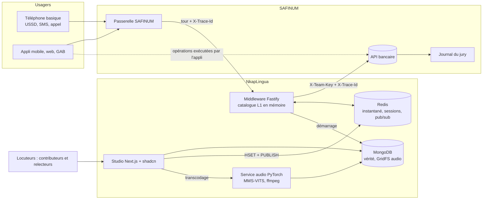
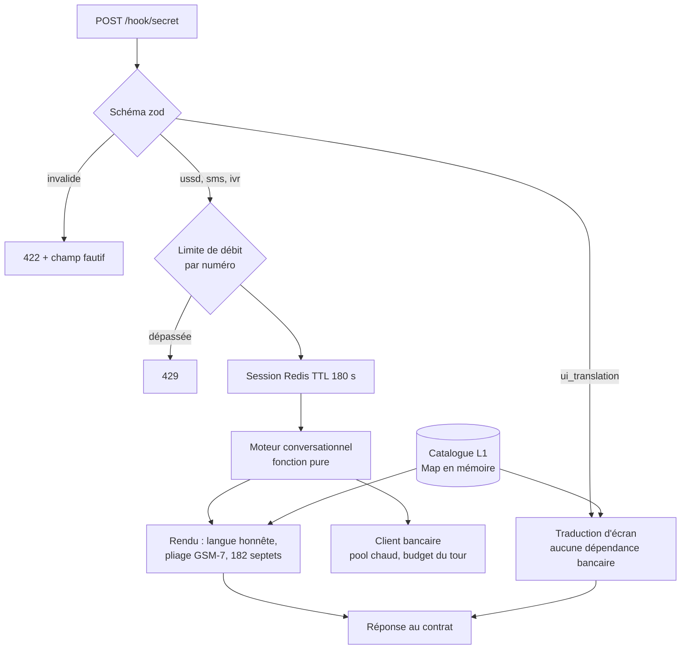
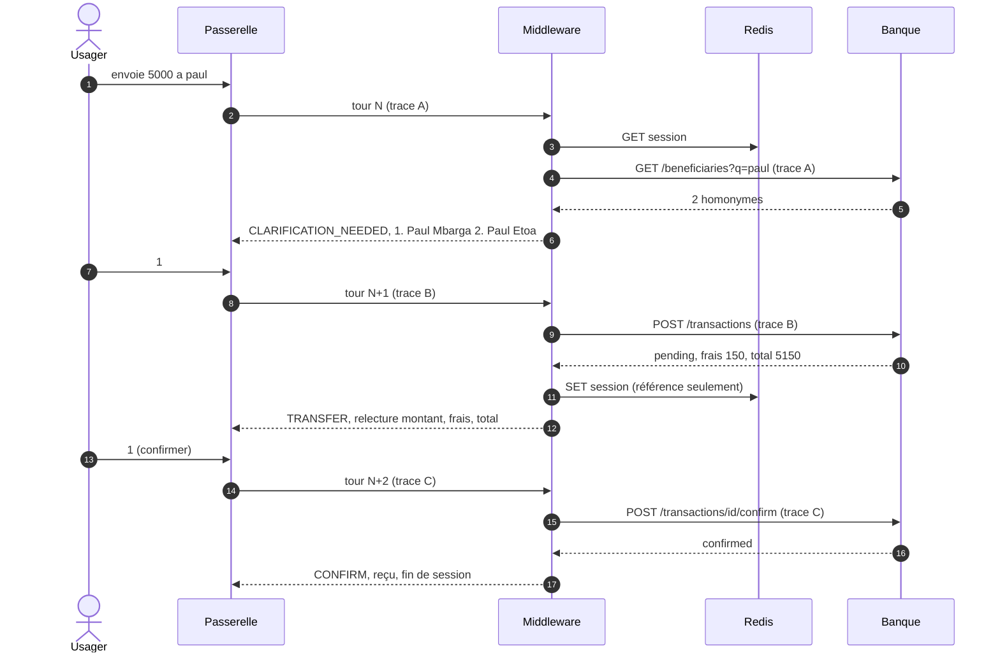
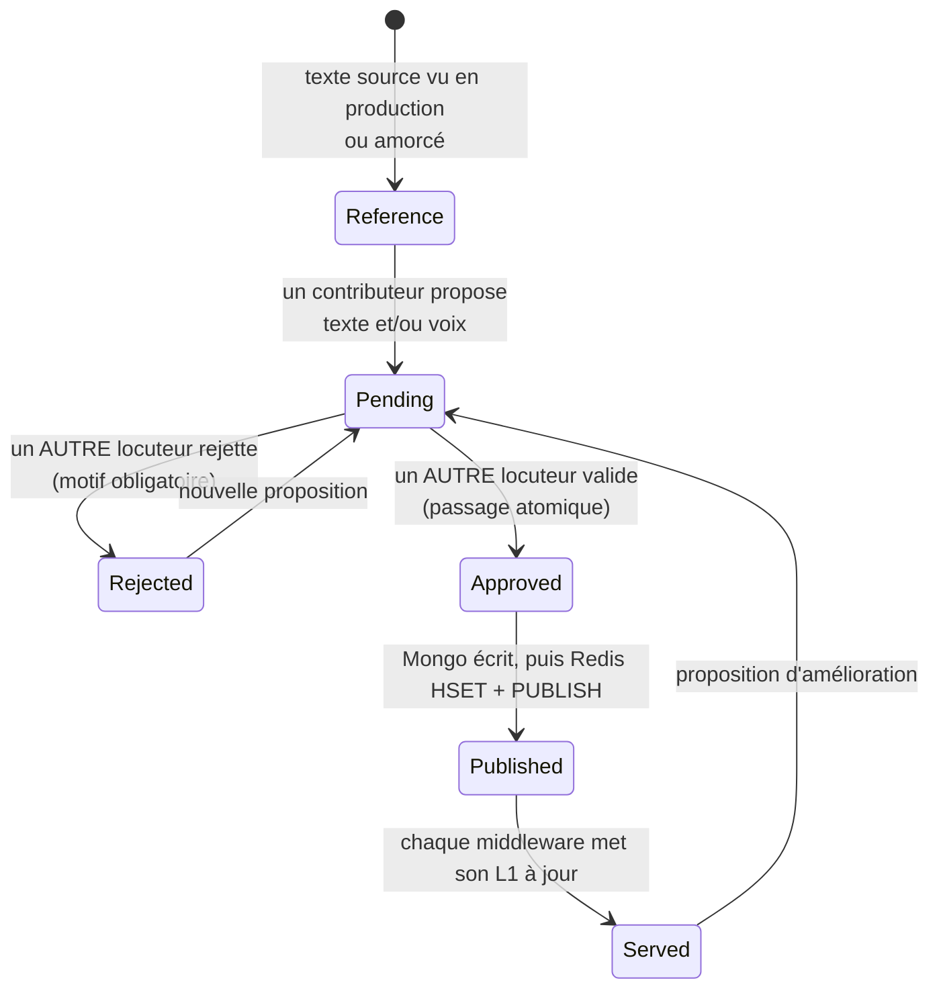
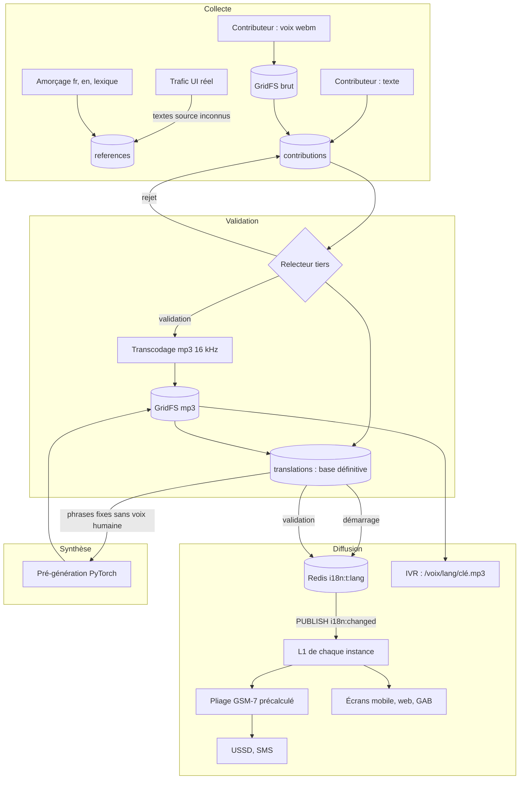
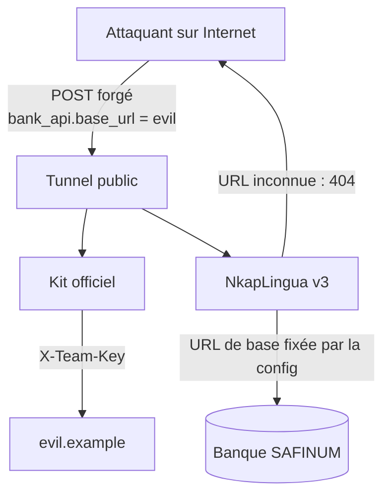
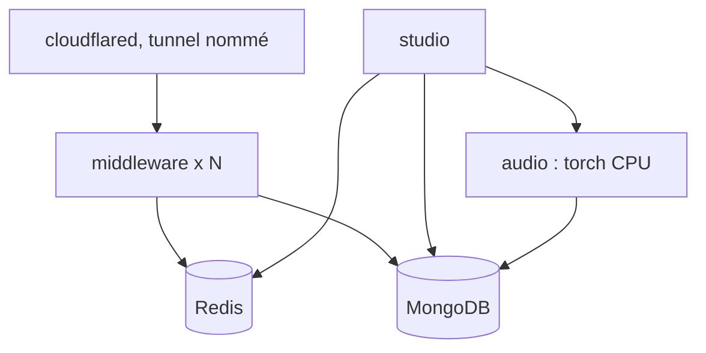

# NkapLingua v3 : architecture technique

> Tout le monde devrait pouvoir parler le langage de l'argent.

Stack : Node.js 22 (Fastify, TypeScript strict), MongoDB 7, Redis 7, PyTorch (MMS-VITS), Next.js 15 + shadcn/ui.

## 1. Vue d'ensemble

Deux familles de canaux, deux régimes de sécurité :

| Canaux | Ce que voit le middleware | Appels bancaires |
| --- | --- | --- |
| mobile, web, GAB | des gabarits (`{amount}`, `{name}`), jamais une valeur | aucun : l'appli opère elle-même |
| USSD, SMS, IVR | la saisie de l'usager (le contrat l'impose) | oui, avec la clé d'équipe |

## 2. Le middleware de l'intérieur

Choix structurants :

- **Catalogue L1 en mémoire.** Redis n'est jamais lu pendant un tour. Mesure : 1,9 µs par écran de 40 clés en L1 contre 1 865 µs avec un `HGET` Redis par clé (même en local).
- **Pool HTTP chaud vers la banque.** Keep-alive 60 s et ping de maintien toutes les 20 s. Le `fetch` par défaut ferme au bout de 4 s, or un usager USSD met plus longtemps que ça à lire et taper : chaque tour repaierait la poignée TLS.
- **Budget du tour.** Chaque appel bancaire reçoit le temps restant avant l'échéance du canal (3 s en USSD), moins une marge, et pas un délai fixe.
- **Écrans décrits par des clés.** Un écran peut être rejoué dans une autre langue sans perdre l'opération en cours.

## 3. Transfert en deux tours (règle du jury)

Jamais de confirmation dans le tour qui crée. Après création, les montants affichés viennent de la banque, pas de la session.

## 4. Studio : cycle de vie d'une traduction

Garanties :

- **Quatre yeux.** Le filtre Mongo de la validation contient `authorId: { $ne: relecteur }` : l'interface ne peut pas le contourner.
- **Pas de double publication.** Le passage `pending -> approved` est un `findOneAndUpdate` conditionnel.
- **Mêmes contrôles partout.** Emplacements, `max_chars` et 182 septets sont vérifiés par la même fonction dans le navigateur (aperçu) et sur le serveur (refus).

## 5. Pipeline de données

| Étape | Stockage | Format | Garantie |
| --- | --- | --- | --- |
| Référence | `references` | texte fr, contexte, `max_chars`, canaux | découverte automatique, hors chemin critique (lot toutes les 5 s) |
| Proposition | `contributions` + GridFS | texte, audio brut | jamais servie |
| Validation | `translations` | texte, `audioId` mp3, auteur, relecteur, version | un tiers a relu |
| Instantané | Redis `i18n:t:<lang>` | JSON `{t, a}` | écrit en `MULTI` : jamais à moitié |
| Service | L1 en mémoire | texte + variante GSM-7 | O(1), aucun aller-retour réseau |

Ordre au démarrage : Mongo vers Redis vers L1. Si Mongo est absent, on démarre sur l'instantané Redis. Si les deux sont absents, sur la graine embarquée (fr, en). Le service répond toujours.

Une voix humaine validée n'est jamais écrasée par la synthèse : la pré-génération ne touche que les traductions sans `audioId`.

## 6. Lettres à tons et USSD

Un seul caractère hors GSM-7 fait passer le message en UCS-2 : la limite tombe de 182 à 70 caractères. Le pliage est calculé une fois, à l'écriture dans le L1.

| Source | GSM-7 | Coût | Raison |
| --- | --- | --- | --- |
| ŋ ɓ ɗ ƙ ƴ | ng bh dh kh yh | 2 septets | consonnes composées, lisibles |
| ɛ ɔ | è ò | 1 septet | déjà dans GSM-7, distinctes de e et o |
| ə | eu | 2 septets | lecture francophone de la voyelle centrale |
| tons (á à â ǎ) | retirés | 0 | uniformément, pour ne pas mélanger ton et voyelle |

Choix discuté : un digraphe pour les voyelles (« eh », « oh ») entrerait en collision avec des suites réelles et coûterait le double. Les règles sont des données : surchargeables langue par langue (`fold_rules`).

## 7. Sécurité

| Menace | Contre-mesure | Preuve |
| --- | --- | --- |
| Vol de la clé par `bank_api.base_url` forgé | l'URL vient de la config, origine en liste blanche | `bench/exfil-demo.ts` : le kit fuit, la v3 non |
| Appels par un tiers | URL déclarée secrète `/hook/<secret>`, comparaison à temps constant | test : 404 sur `/` et mauvais secret |
| Abus de la banque via nous | limite de débit par numéro (Redis) | test 429 |
| Fuite dans les journaux | numéros masqués, saisies jamais journalisées, secret masqué dans l'URL | `maskPhone` |
| Données financières dans l'UI | gabarits seulement, module UI sans client bancaire | séparation par injection |
| Relecture complaisante | quatre yeux imposés dans la requête Mongo | e2e : la contributrice est refusée |
| Session du studio | JWT HS256 httpOnly, rôles relus en base à chaque requête | |
| Clé commitée | `.env` retiré du suivi ; **à faire côté équipe : faire révoquer la clé de l'historique git** | |

## 8. Déploiement

`infra/docker-compose.yml` lance l'ensemble. Le middleware est sans état : il se met à l'échelle derrière le tunnel, Redis porte les sessions et la diffusion.
