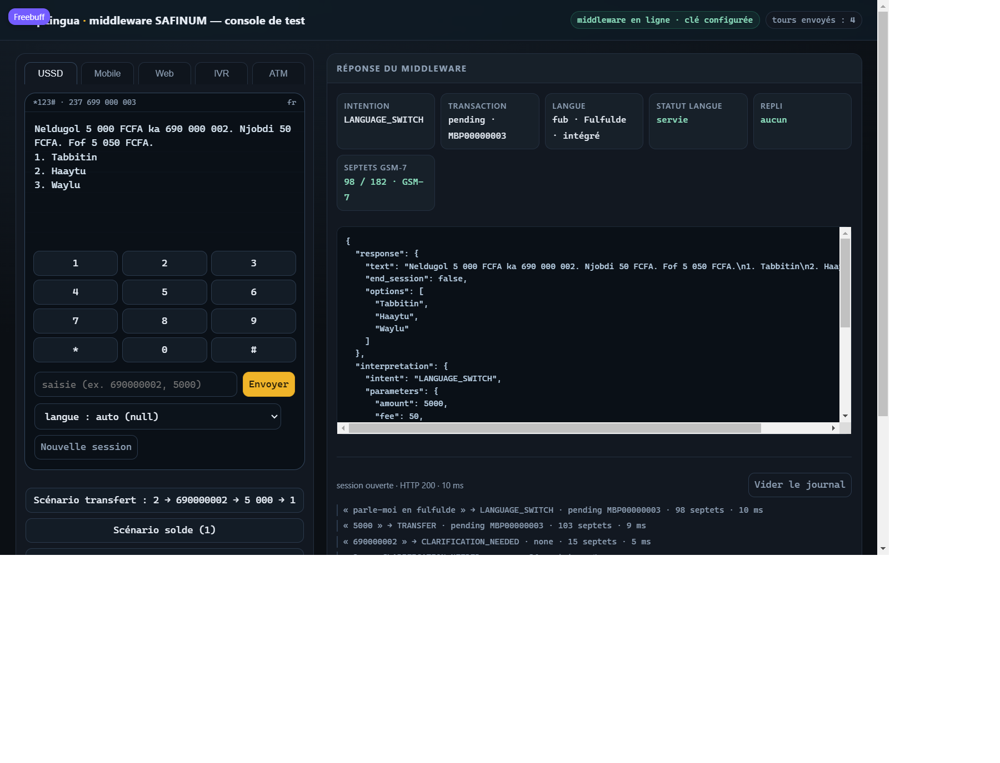
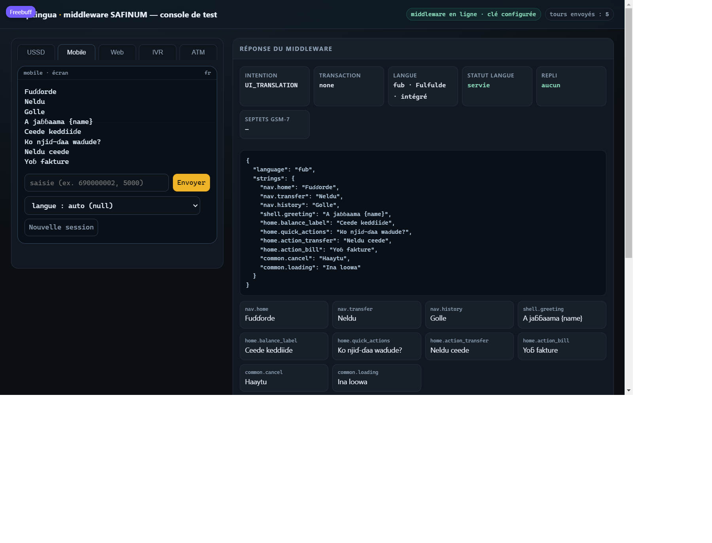
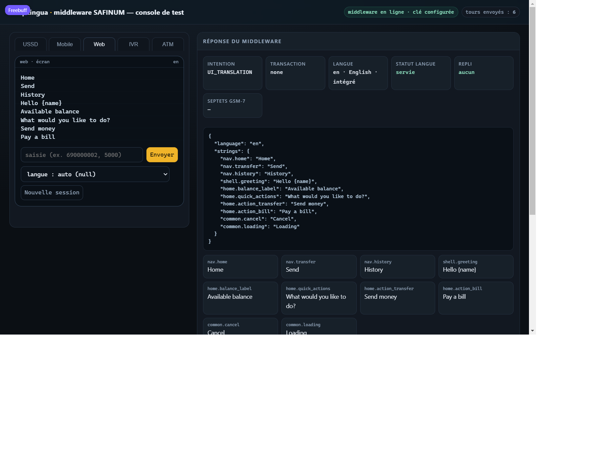
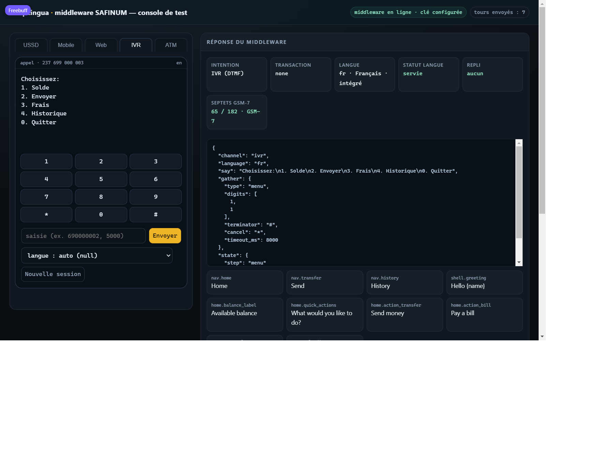
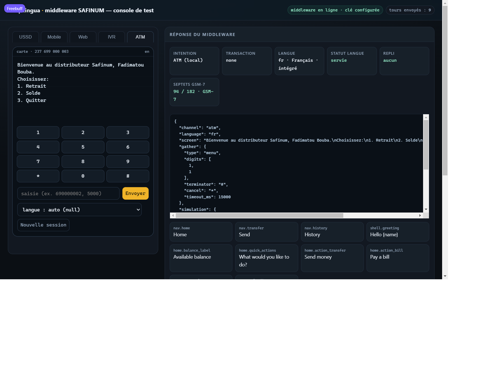
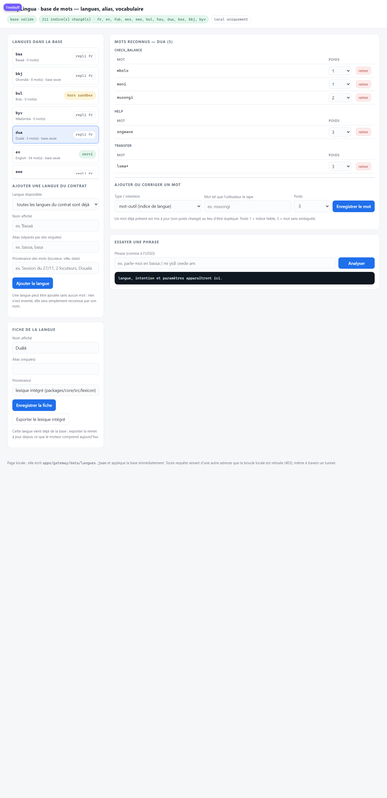
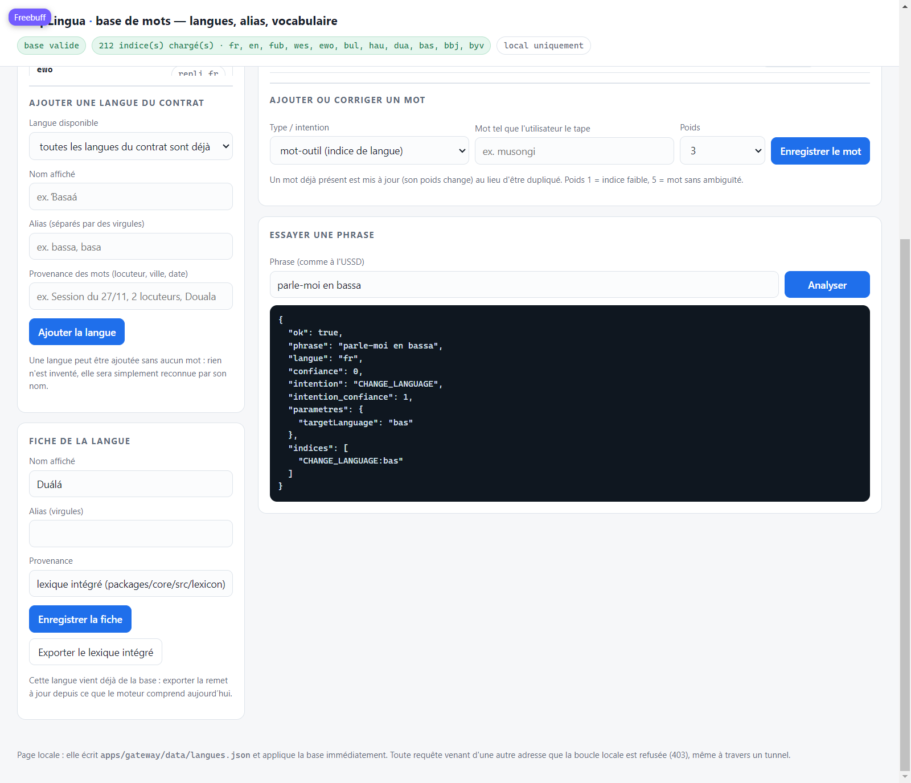

# NkapLingua — la démonstration, capture par capture

Neuf captures prises **sur le projet tel qu'il tourne** (banque de démonstration + middleware local,
`ENABLE_V2_CHANNELS=1`, 27/11/2026), avec le même parcours que le jour J. Chaque capture dit trois
choses : **ce qu'on voit**, **ce qu'on raconte**, **ce que ça prouve**.

Console : <http://127.0.0.1:8080/console> · base de mots : <http://127.0.0.1:8080/langues-admin>

> Les captures sont aussi les images utilisées dans `docs/presentation/`. Elles ne contiennent
> aucune clé : le middleware garde `SAFINUM_TEAM_KEY` côté serveur, la page ne l'affiche jamais.

---

## 1. Console USSD — le point d'entrée

**On voit** : la console de test avec les cinq onglets (`USSD`, `Mobile`, `Web`, `IVR`, `ATM`), le
téléphone virtuel avec le menu à huit entrées, le pavé numérique, le sélecteur de langue, et à droite
les indicateurs de réponse.

**On raconte** : « C'est la même page que je vais utiliser pour tous les canaux. À gauche ce que le
client tape, à droite ce que le middleware répond, avec la langue réellement servie. »

**Ce que ça prouve** : un seul middleware, une seule URL, cinq canaux — et la console ne triche pas :
elle envoie de vraies requêtes HTTP.

## 2. USSD — transfert, récapitulatif avant toute action

**On voit** : la saisie `2 → 690000002 → 5000` mène au récapitulatif `Envoi de 5 000 FCFA à
690 000 002. Frais 50 FCFA. Total 5 050 FCFA`, avec `1. Confirmer / 2. Annuler / 3. Modifier`.
À droite : `intention TRANSFER`, `transaction pending · MBP00000003`, `langue fr`, `statut servi`,
`repli aucun`, `103 / 182 septets · GSM-7`.

**On raconte** : « Rien n'est débité à ce tour. La transaction est créée en attente, avec un
identifiant, et ne sera confirmée qu'au tour suivant. Le compteur de septets garantit qu'on ne
dépasse jamais 182 caractères GSM-7. »

**Ce que ça prouve** : le cycle du règlement (récapitulatif → confirmation séparée → trace bancaire),
et la contrainte d'écran USSD mesurée en direct.

## 3. USSD — « parle-moi en fulfulde » pendant la confirmation

**On voit** : la même transaction en attente (`MBP00000003`), mais le récapitulatif s'affiche en
fulfulde — `Neldugol 5 000 FCFA ka 690 000 002. Njobdi 50 FCFA. Fof 5 050 FCFA.` — avec les options
`1. Tabbitin / 2. Haaytu / 3. Waylu`. À droite : `intention LANGUAGE_SWITCH`, `langue fub ·
Fulfulde · intégré`, `statut servi`, `repli aucun`, `98 / 182 septets`.

**On raconte** : « Le client change de langue *au milieu* d'une confirmation. On ne perd pas la
transaction, on ne le renvoie pas au menu : on réaffiche le récapitulatif dans la nouvelle langue. »

**Ce que ça prouve** : le bug corrigé (avant, cette phrase tombait sur « Répondez 1 pour confirmer »),
la détection de langue en cours de dialogue, et le fait que la langue annoncée est celle réellement
affichée.

## 4. Mobile — traduction d'écran en fulfulde

**On voit** : l'onglet `Mobile`, six chaînes d'écran traduites (`Fuɗɗorde`, `Neldu`, `Golle`,
`Ceede keddiiɗe`, `Ko njiɗ-ɗaa waɗude?`, `Yoƴ fakture`), la réponse JSON `{"language":"fub","strings":{…}}`
et les cartes clé/valeur. En haut : `langue fub · Fulfulde · intégré`, `statut servi`.

**On raconte** : « Le canal mobile ne reçoit pas des phrases, mais des clés d'interface. On renvoie
exactement les clés demandées, dans la langue demandée, sans jamais mélanger deux langues. »

**Ce que ça prouve** : `ui_translation` respecte le contrat (mêmes clés, `language` déclarée), et le
pack intégré couvre les 89 clés d'écran.

## 5. Web — traduction d'écran en anglais

**On voit** : l'onglet `Web` avec la même demande d'écran, en `en` : `Home`, `Send`, `History`,
`Hello {name}`, `Available balance`, `What would you like to do?`, `Send money`, `Pay a bill`.
Les emplacements `{name}` sont conservés tels quels.

**On raconte** : « Même moteur, autre langue, autre canal. Les variables ne sont jamais traduites :
`{name}` reste `{name}`, sinon l'application casse. »

**Ce que ça prouve** : le canal web et le respect des emplacements — un détail qui élimine beaucoup
de concurrents en démonstration.

## 6. IVR — le même moteur, au téléphone (DTMF)

**On voit** : l'onglet `IVR`, `appel · 237 699 000 003`, le menu vocal `1. Solde / 2. Envoyer /
3. Frais / 4. Historique / 0. Quitter`, et à droite `channel: "ivr"`, `gather: {type:"menu",
terminator:"#", cancel:"*", timeout_ms:8000}`.

**On raconte** : « C'est un canal *local*, hors contrat SAFINUM : la sandbox n'expose que trois
canaux. Mais c'est le même moteur : transaction en attente, confirmation séparée, `*` annule et
annule la transaction côté banque. »

**Ce que ça prouve** : l'IVR n'est pas une maquette — il appelle la même banque, et la réponse est
un vrai `gather` DTMF, exploitable par n'importe quel central.

## 7. ATM — le distributeur, honnêtement simulé

**On voit** : l'onglet `ATM`, `carte · 237 699 000 003`, `Bienvenue au distributeur Safinum,
Fadimatou Bouba` puis `1. Retrait / 2. Solde / 3. Quitter`, et dans le JSON
`simulation: {…}` avec `bankRoute: "none"`.

**On raconte** : « L'API bancaire SAFINUM n'a pas de route de retrait : le distributeur applique les
vraies règles (multiple de 5 000, plafond, frais, solde suffisant) mais **dit** que la remise
d'espèces est simulée. On préfère l'écrire que le laisser croire. »

**Ce que ça prouve** : le canal le plus tentant à falsifier est celui où l'honnêteté est la plus
visible — et il est testé (plafond, coupures, code non vérifié par la banque).

## 8. Base de mots — l'interface d'ajout et de modification des langues

**On voit** : la page `/langues-admin`. À gauche, **la liste des langues de la base** (elle défile ; le
bandeau en haut confirme les 11 langues chargées), avec leur état :
`fr`, `en`, `fub` (`servi`), `dua`, `ewo`, `bas`, `bbj`, `byv` (`repli fr`), `bul`, `hau`, `wes`
(`hors sandbox`). Puis le formulaire **Ajouter une langue du contrat** (nom, alias, provenance) et
la **fiche de la langue** (nom, alias, provenance, `Enregistrer la fiche`, `Exporter le lexique
intégré`). À droite, **les mots reconnus** de la langue sélectionnée (`dua` : `mbolo`, `moni`,
`musongi`, `ongwane`, `loma`), chacun avec son **poids modifiable 1–5** et un bouton `retirer`, puis
le formulaire **Ajouter ou corriger un mot** (type/intention, mot, poids) et **Essayer une phrase**.

**On raconte** : « Un linguiste n'a pas besoin de terminal : il ajoute une langue, corrige un alias,
change un poids, et le moteur le prend en compte immédiatement. Aucune écriture n'est appliquée à
moitié : la base est validée en bloc avant d'être enregistrée. »

**Ce que ça prouve** : la « petite base de données » est utilisable par un humain, pas seulement par
un développeur — et la page refuse les requêtes qui ne viennent pas de la machine locale (403).

## 9. Base de mots — essayer une phrase, voir ce que le moteur comprend

**On voit** : la phrase `parle-moi en bassa` analysée en direct : `intention: "CHANGE_LANGUAGE"`,
`parametres: {"targetLanguage": "bas"}`, `indices: ["CHANGE_LANGUAGE:bas"]`, sous un bandeau
`base valide · 212 indice(s) chargé(s) · fr, en, fub, wes, ewo, bul, hau, dua, bas, bbj, byv`.

**On raconte** : « `bassa` n'est pas dans le code : c'est un alias ajouté dans la base. On le tape
ici, on voit immédiatement la langue cible et l'indice qui a déclenché la décision. »

**Ce que ça prouve** : la boucle complète **ajouter → comprendre → vérifier**, sans redémarrage et
sans redéploiement. C'est ce qui rend le vocabulaire corrigeable le jour de la relecture.

---

## Le parcours de démonstration (≈ 6 minutes)

| Temps | Action | Ce qu'on dit |
| --- | --- | --- |
| 0:00 | Capture 1 | « Un seul middleware, cinq canaux, une console qui envoie de vraies requêtes. » |
| 0:40 | Capture 2 | « Récapitulatif avant débit, confirmation au tour suivant, 103 septets sur 182. » |
| 1:30 | Capture 3 | « Changement de langue en pleine confirmation : rien n'est perdu. » |
| 2:20 | Captures 4 et 5 | « Écrans traduits en fulfulde puis en anglais, emplacements préservés. » |
| 3:20 | Captures 6 et 7 | « IVR et ATM : même moteur ; le distributeur dit qu'il simule. » |
| 4:20 | Capture 8 | « Une langue s'ajoute ici, sans code ni redéploiement. » |
| 5:10 | Capture 9 | « Et on vérifie tout de suite ce que le moteur comprend. » |
| 5:40 | `docs/preuves/` | « Les preuves : 10 scénarios et un tour par canal, horodatés. » |

## Ce que ces captures ne prouvent pas

- **Les captures locales ne prouvent pas la sandbox.** Celles de ce document viennent du serveur
  local et de la banque de démonstration. Les six canaux ont par ailleurs été joués **en direct**
  sur la sandbox le 27/11/2026 : voir [SIX-CANAUX](SIX-CANAUX.md) et
  `docs/preuves/six-canaux-2026-11-27.json`. Les deux preuves ne se remplacent pas : l'une montre
  le dialogue complet, l'autre montre que la passerelle nous atteint et journalise nos appels.
- **Le tunnel nommé** : il demande un domaine chez Cloudflare et une action humaine
  (`docs/TUNNEL-NOMME.md`). Le jour J, c'est `pnpm tunnel:named` qui déclare l'URL figée.
- **La relecture fulfulde** : `docs/relecture/fub.md` est une fiche **à faire signer**. Tant que
  deux locuteurs ne l'ont pas signée, les formes fulfulde restent déclarées « proposées », pas
  « validées ».
- **La voix** : 112 clips `facebook/mms-tts` (fr et en) sont servis par `GET /audio/*` et attachés à
  `POST /ivr` ; les cinq langues camerounaises n'ont **aucun** modèle publié et restent sans audio
  (`voice.model: null`). Le studio humain est décrit dans `docs/GUIDE-STUDIO-ENREGISTREMENT.md`.

## Les six canaux (preuve en direct, 27/11/2026)

Les captures ci-dessous sont les réponses **réelles** de `POST /api/v1/channel/<canal>` sur la
sandbox, recopiées depuis `docs/preuves/six-canaux-2026-11-27.json`.

| Canal | Ce qu'on voit | Ce qu'on raconte | Ce que ça prouve |
| --- | --- | --- | --- |
| USSD | `Safinum. Choisissez:` + 8 entrées | « Le menu vient de notre middleware, pas du simulateur. » | la passerelle nous appelle et journalise le tour |
| Mobile | `screen: home`, `translation.language: fr`, `strings` complets | « Chaque clé d'écran est traduite ou déclarée. » | la traduction clé par clé fonctionne |
| Web | idem mobile | « Même contrat, même moteur. » | un seul middleware sert deux canaux d'écran |
| SMS | même menu, `sms: {encoding: gsm7, segments: 1}` | « Le découpage facturé est annoncé. » | la contrainte 160/70 est mesurée, pas supposée |
| ATM | `screen: atm_welcome`, `strings` ATM | « Le distributeur parle la même langue. » | le canal ATM est branché (retrait simulé, déclaré) |
| IVR | `Choisissez: 1. Solde 2. Envoyer…` | « Le téléphone reçoit du texte, prêt à être dit. » | le canal vocal répond sans audio inventé |

Ce que ces six captures **ne** prouvent pas : elles sont en `fr` et ne montrent que `home` et
`atm_welcome`. Les **23 écrans** (6 mobile, 6 web, 11 ATM) ont depuis été rejoués en `en` sur la
sandbox, `missing: []` et 47 clés `atm.*` servies : voir `docs/preuves/ecrans-2026-11-27.json` et
[SIX-CANAUX](SIX-CANAUX.md) §6. Les langues camerounaises restent au repli `fr` faute de packs
relus, et le retrait ATM reste simulé (la sandbox n'a pas de route de retrait).
