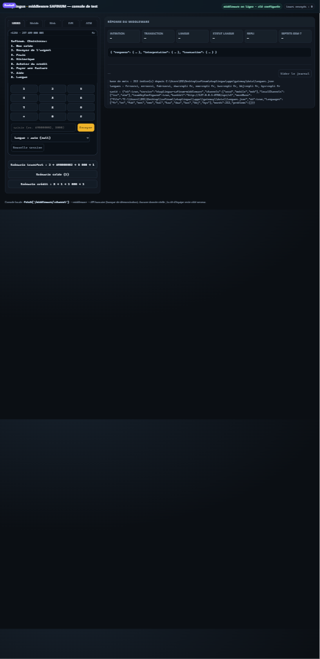

# NkapLingua — la démonstration, capture par capture

Neuf captures **locales** prises sur le projet tel qu'il tourne (banque de démonstration + middleware
local, `ENABLE_V2_CHANNELS=1`, 27/11/2026), avec le même parcours que le jour J. Chaque capture dit
trois choses : **ce qu'on voit**, **ce qu'on raconte**, **ce que ça prouve**.

S'y ajoutent, plus bas, les **réponses HTTP réelles de la sandbox** : un tour par canal (les six) et
onze parcours par fonctionnalité, copiés de `docs/preuves/six-canaux-2026-11-27.json` et
`docs/preuves/parcours-2026-11-27.json`. Ce ne sont pas des maquettes : les textes, intentions,
statuts et références sont ceux que la passerelle a renvoyés le 27/11/2026.

Console : <http://127.0.0.1:8080/console> · base de mots : <http://127.0.0.1:8080/langues-admin>

> Les captures sont aussi les images utilisées dans `docs/presentation/`. Elles ne contiennent
> aucune clé : le middleware garde `SAFINUM_TEAM_KEY` côté serveur, la page ne l'affiche jamais.

---

## 1. Console USSD — le point d'entrée



**On voit** : la console de test avec les cinq onglets (`USSD`, `Mobile`, `Web`, `IVR`, `ATM`), le
téléphone virtuel avec le menu à huit entrées, le pavé numérique, le sélecteur de langue, et à droite
les indicateurs de réponse.

**On raconte** : « C'est la même page que je vais utiliser pour tous les canaux. À gauche ce que le
client tape, à droite ce que le middleware répond, avec la langue réellement servie. »

**Ce que ça prouve** : un seul middleware, une seule URL, **six** canaux — et la console ne triche
pas : elle envoie de vraies requêtes HTTP. Le SMS n'a pas d'onglet dédié : il passe par le même menu,
avec le découpage GSM-7 mesuré (voir plus bas).

## 2. USSD — transfert, récapitulatif avant toute action


**On voit** : la saisie `2 → 690000002 → 5000` mène au récapitulatif `Envoi de 5 000 FCFA à
690 000 002. Frais 50 FCFA. Total 5 050 FCFA`, avec `1. Confirmer / 2. Annuler / 3. Modifier`.
À droite : `intention TRANSFER`, `transaction pending · MBP00000003`, `langue fr`, `statut servi`,
`repli aucun`, `103 / 182 septets · GSM-7`.

**On raconte** : « Rien n'est débité à ce tour. La transaction est créée en attente, avec un
identifiant, et ne sera confirmée qu'au tour suivant. Le compteur de septets garantit qu'on ne
dépasse jamais 182 caractères GSM-7. »

**Ce que ça prouve** : le cycle du règlement (récapitulatif → confirmation séparée → trace bancaire),
et la contrainte d'écran USSD mesurée en direct.

## 3. USSD — « parle-moi en fulfulde » pendant la confirmation


**On voit** : la même transaction en attente (`MBP00000003`), mais le récapitulatif s'affiche en
fulfulde — `Neldugol 5 000 FCFA ka 690 000 002. Njobdi 50 FCFA. Fof 5 050 FCFA.` — avec les options
`1. Tabbitin / 2. Haaytu / 3. Waylu`. À droite : `intention LANGUAGE_SWITCH`, `langue fub ·
Fulfulde · intégré`, `statut servi`, `repli aucun`, `98 / 182 septets`.

**On raconte** : « Le client change de langue *au milieu* d'une confirmation. On ne perd pas la
transaction, on ne le renvoie pas au menu : on réaffiche le récapitulatif dans la nouvelle langue. »

**Ce que ça prouve** : le bug corrigé (avant, cette phrase tombait sur « Répondez 1 pour confirmer »),
la détection de langue en cours de dialogue, et le fait que la langue annoncée est celle réellement
affichée.

## 4. Mobile — traduction d'écran en fulfulde


**On voit** : l'onglet `Mobile`, six chaînes d'écran traduites (`Fuɗɗorde`, `Neldu`, `Golle`,
`Ceede keddiiɗe`, `Ko njiɗ-ɗaa waɗude?`, `Yoƴ fakture`), la réponse JSON `{"language":"fub","strings":{…}}`
et les cartes clé/valeur. En haut : `langue fub · Fulfulde · intégré`, `statut servi`.

**On raconte** : « Le canal mobile ne reçoit pas des phrases, mais des clés d'interface. On renvoie
exactement les clés demandées, dans la langue demandée, sans jamais mélanger deux langues. »

**Ce que ça prouve** : `ui_translation` respecte le contrat (mêmes clés, `language` déclarée), et le
pack intégré couvre les 89 clés d'écran.

## 5. Web — traduction d'écran en anglais


**On voit** : l'onglet `Web` avec la même demande d'écran, en `en` : `Home`, `Send`, `History`,
`Hello {name}`, `Available balance`, `What would you like to do?`, `Send money`, `Pay a bill`.
Les emplacements `{name}` sont conservés tels quels.

**On raconte** : « Même moteur, autre langue, autre canal. Les variables ne sont jamais traduites :
`{name}` reste `{name}`, sinon l'application casse. »

**Ce que ça prouve** : le canal web et le respect des emplacements — un détail qui élimine beaucoup
de concurrents en démonstration.

## 6. IVR — le même moteur, au téléphone (DTMF)


**On voit** : l'onglet `IVR`, `appel · 237 699 000 003`, le menu vocal `1. Solde / 2. Envoyer /
3. Frais / 4. Historique / 0. Quitter`, et à droite `channel: "ivr"`, `gather: {type:"menu",
terminator:"#", cancel:"*", timeout_ms:8000}`.

**On raconte** : « Cette page appelle notre route locale, mais la sandbox ouvre elle aussi un canal
`ivr` : même moteur, même menu, même banque. Transaction en attente, confirmation séparée, `*`
annule et annule la transaction côté banque. »

**Ce que ça prouve** : l'IVR n'est pas une maquette — il appelle la même banque, et la réponse est
un vrai `gather` DTMF, exploitable par n'importe quel central.

## 7. ATM — le distributeur, honnêtement simulé


**On voit** : l'onglet `ATM`, `carte · 237 699 000 003`, `Bienvenue au distributeur Safinum,
Fadimatou Bouba` puis `1. Retrait / 2. Solde / 3. Quitter`, et dans le JSON
`simulation: {…}` avec `bankRoute: "none"`.

**On raconte** : « Sur la sandbox, le canal `atm` est un canal d'écrans : on traduit les 11 écrans
(`atm_welcome`…`atm_end`, 47 clés). Le retrait, lui, n'a pas de route bancaire : le distributeur
local applique les vraies règles (multiple de 5 000, plafond, frais, solde suffisant) mais **dit**
que la remise d'espèces est simulée. On préfère l'écrire que le laisser croire. »

**Ce que ça prouve** : le canal le plus tentant à falsifier est celui où l'honnêteté est la plus
visible — et il est testé (plafond, coupures, code non vérifié par la banque).

## 8. Base de mots — l'interface d'ajout et de modification des langues


**On voit** : la page `/langues-admin`. À gauche, **la liste des langues de la base** (elle défile ; le
bandeau en haut confirme les 11 langues chargées), avec leur état :
`fr`, `en`, `fub` (`servi`), `dua`, `ewo`, `bas`, `bbj`, `byv` (`repli fr`), `bul`, `hau`, `wes`
(`hors sandbox`). Puis le formulaire **Ajouter une langue du contrat** (nom, alias, provenance) et
la **fiche de la langue** (nom, alias, provenance, `Enregistrer la fiche`, `Exporter le lexique
intégré`). À droite, **les mots reconnus** de la langue sélectionnée (`dua` : `mbolo`, `moni`,
`musongi`, `ongwane`, `loma`), chacun avec son **poids modifiable 1–5** et un bouton `retirer`, puis
le formulaire **Ajouter ou corriger un mot** (type/intention, mot, poids) et **Essayer une phrase**.

**On raconte** : « Un linguiste n'a pas besoin de terminal : il ajoute une langue, corrige un alias,
change un poids, et le moteur le prend en compte immédiatement. Aucune écriture n'est appliquée à
moitié : la base est validée en bloc avant d'être enregistrée. »

**Ce que ça prouve** : la « petite base de données » est utilisable par un humain, pas seulement par
un développeur — et la page refuse les requêtes qui ne viennent pas de la machine locale (403).

## 9. Base de mots — essayer une phrase, voir ce que le moteur comprend


**On voit** : la phrase `parle-moi en bassa` analysée en direct : `intention: "CHANGE_LANGUAGE"`,
`parametres: {"targetLanguage": "bas"}`, `indices: ["CHANGE_LANGUAGE:bas"]`, sous un bandeau
`base valide · 212 indice(s) chargé(s) · fr, en, fub, wes, ewo, bul, hau, dua, bas, bbj, byv`.

**On raconte** : « `bassa` n'est pas dans le code : c'est un alias ajouté dans la base. On le tape
ici, on voit immédiatement la langue cible et l'indice qui a déclenché la décision. »

**Ce que ça prouve** : la boucle complète **ajouter → comprendre → vérifier**, sans redémarrage et
sans redéploiement. C'est ce qui rend le vocabulaire corrigeable le jour de la relecture.

---

## Le parcours de démonstration (≈ 6 minutes)

| Temps | Action | Ce qu'on dit |
| --- | --- | --- |
| 0:00 | Capture 1 | « Un seul middleware, six canaux, une console qui envoie de vraies requêtes. » |
| 0:40 | Capture 2 | « Récapitulatif avant débit, confirmation au tour suivant, 103 septets sur 182. » |
| 1:30 | Capture 3 | « Changement de langue en pleine confirmation : rien n'est perdu. » |
| 2:20 | Captures 4 et 5 | « Écrans traduits en fulfulde puis en anglais, emplacements préservés. » |
| 3:20 | Captures 6 et 7 | « IVR et ATM : même moteur ; sur la sandbox l'ATM traduit ses écrans, le retrait local dit qu'il simule. » |
| 4:20 | Capture 8 | « Une langue s'ajoute ici, sans code ni redéploiement. » |
| 5:10 | Capture 9 | « Et on vérifie tout de suite ce que le moteur comprend. » |
| 5:40 | `docs/preuves/` | « Les preuves : 10 scénarios et un tour par canal, horodatés. » |

## Ce que les captures locales ne prouvent pas

- **Les captures locales ne prouvent pas la sandbox.** Celles de ce document viennent du serveur
  local et de la banque de démonstration. Les six canaux ont par ailleurs été joués **en direct**
  sur la sandbox le 27/11/2026 : voir [SIX-CANAUX](SIX-CANAUX.md) et
  `docs/preuves/six-canaux-2026-11-27.json`. Les deux preuves ne se remplacent pas : l'une montre
  le dialogue complet, l'autre montre que la passerelle nous atteint et journalise nos appels.
- **Le tunnel nommé** : il demande un domaine chez Cloudflare et une action humaine
  (`docs/TUNNEL-NOMME.md`). Le jour J, c'est `pnpm tunnel:named` qui déclare l'URL figée.
- **La relecture fulfulde** : `docs/relecture/fub.md` est une fiche **à faire signer**. Tant que
  deux locuteurs ne l'ont pas signée, les formes fulfulde restent déclarées « proposées », pas
  « validées ».
- **La voix** : 112 clips `facebook/mms-tts` (fr et en) sont servis par `GET /audio/*` et attachés à
  `POST /ivr` ; les cinq langues camerounaises n'ont **aucun** modèle publié et restent sans audio
  (`voice.model: null`). Le studio humain est décrit dans `docs/GUIDE-STUDIO-ENREGISTREMENT.md`.

## Les six canaux, réponse par réponse (sandbox, 27/11/2026)

Un appel réel par canal via `POST /api/v1/channel/<canal>`, avec `X-Team-Key` et `X-Sandbox-Access`,
vers l'URL déclarée. Preuve brute : `docs/preuves/six-canaux-2026-11-27.json` (générée par
`node scripts/six-canaux.mjs`, code de sortie 0).

### 1. USSD — le menu vient du middleware

```json
{"channel":"ussd","response":{"text":"Safinum. Choisissez: 1. Mon solde … 8. Langue"},
 "interpretation":{"language":"fr"},"transaction":{"status":"none"},
 "diagnostics":{"response_length":139,"max_chars":182,"over_limit":false,"gsm7_violations":[]}}
```

**On voit** : les huit entrées du menu, `langue fr`, aucun code d'erreur, **139 caractères sur 182**
et zéro violation GSM-7. **On raconte** : « Ce menu n'est pas celui du simulateur : c'est notre
middleware qui l'a composé et la passerelle l'a affiché. » **Ce que ça prouve** : la passerelle nous
atteint, journalise notre tour (`trace_id`), et la contrainte d'écran est mesurée, pas supposée.

### 2. Mobile — 30 clés d'écran, aucune manquante

```json
{"channel":"mobile","screen":"home","translation":{"language":"fr",
 "strings":{"nav.home":"Accueil","nav.transfer":"Envoyer","home.balance_label":"Solde disponible",
            "shell.greeting":"Bonjour {name}", …}}}
```

**On voit** : `screen: home`, 30 clés renvoyées, aucun code d'erreur ; le même écran rejoué en `en`
donne **30/30 traduites, `missing: []`** (`docs/preuves/ecrans-2026-11-27.json`). **On raconte** :
« Chaque clé demandée revient, dans la langue demandée ; aucune n'est omise, aucun emplacement
`{name}` n'est cassé. » **Ce que ça prouve** : la traduction clé par clé du contrat `ui_translation`
fonctionne sur le canal mobile.

### 3. Web — le même contrat, 32 clés

```json
{"channel":"web","screen":"home","translation":{"language":"fr",
 "strings":{"nav.home":"Accueil","shell.logout":"Se déconnecter","shell.secure":"Connexion sécurisée", …}}}
```

**On voit** : le même écran `home`, deux clés de plus qu'en mobile (`shell.logout`, `shell.secure`) ;
en `en`, le relevé complet donne **32/32 traduites, `missing: []`**. **On raconte** : « Même moteur,
même URL, autre canal : le web reçoit ses propres clés. » **Ce que ça prouve** : un seul middleware
sert les deux canaux d'écran, sans mélange de jeux de clés.

### 4. SMS — le découpage facturé est annoncé

```json
{"channel":"sms","response":{"text":"Safinum. Choisissez: … 8. Langue"},
 "sms":{"encoding":"gsm7","segments":1,"awaiting_reply":false},
 "diagnostics":{"response_length":139,"max_chars":160,"over_limit":false}}
```

**On voit** : le même menu que l'USSD, mais **139 caractères sur 160**, `gsm7`, **1 segment**.
**On raconte** : « Un SMS se facture au segment : on annonce le nombre exact, ici un seul. »
**Ce que ça prouve** : la contrainte 160/70 puis 153/67 est appliquée et mesurée par la sandbox,
pas seulement par nos tests.

### 5. ATM — l'écran d'accueil, 6 clés servies

```json
{"channel":"atm","screen":"atm_welcome","translation":{"language":"fr",
 "strings":{"atm.bank":"Banque Safinum","atm.insert_card":"Insérez votre carte","atm.welcome":"Bienvenue", …},
 "report":{"total":6,"translated":6,"missing":[],"over_limit":[],"placeholder_errors":[]}}}
```

**On voit** : `screen: atm_welcome`, **6/6 clés**, `missing: []`, aucun `INVALID_RESPONSE` (il y en
avait un avant le correctif : le canal ATM attend une traduction d'écran, pas un dialogue).
**On raconte** : « Le distributeur parle la même langue que l'application. » **Ce que ça prouve** :
le canal ATM est branché sur le contrat d'écran ; les 11 écrans et 47 clés `atm.*` sont servis en
`en` (preuve `ecrans-2026-11-27.json`, `missing: []`).

### 6. IVR — le téléphone reçoit un texte, pas un faux audio

```json
{"channel":"ivr","response":{"text":"Choisissez: 1. Solde 2. Envoyer 3. Frais 4. Historique 0. Quitter"},
 "diagnostics":{"response_length":65,"max_chars":400}}
```

**On voit** : le menu vocal, 65 caractères sur 400, `end_session: false`. **On raconte** : « Le
central reçoit le texte à prononcer ; quand une phrase a un clip exact, on lui ajoute l'audio ; sinon
on n'invente rien. » **Ce que ça prouve** : le canal IVR répond sur la sandbox, et la règle « jamais
de voix française sur du fulfulde » reste tenue (`fub` → `audio: null`, vérifié).

## Les onze parcours par fonctionnalité (sandbox, 27/11/2026)

Même compte de test, même jeton. Preuve brute : `docs/preuves/parcours-2026-11-27.json`.

| Fonctionnalité | Entrée | Réponse réelle | Statut |
| --- | --- | --- | --- |
| Solde | `1` | `Votre solde est de 641 595 FCFA.` | `none` · `BALANCE_INQUIRY` |
| Frais | `3` → `25000` | `Pour 25 000 FCFA: frais 150 FCFA. Total 25 150 FCFA.` | `none` · `FEE_INQUIRY` |
| Historique | `4` | `Vos dernieres operations: 27/11 transfer -5 000 FCFA … bill -1 000 … airtime -1 000` | `none` · `TRANSACTION_HISTORY` |
| Terminologie | `7` → `1` | `Les frais sont ce que la banque retient pour executer une operation.` | `none` · `TERM_EXPLANATION` |
| Langue | `8` → `3` | `Demngal: fub. Safinum. Subo: 1. Ceede am keddiide …` | `fub` · `LANGUAGE_SWITCH` |
| Crédit | `5` → `1` → `1000` → `1` | `Credit de 1 000 FCFA envoye au 650 626 114. Ref TRX-52A480950F.` | `confirmed` |
| Facture | `6` → `1` → `123456789` → `1000` → `1` | `Facture ENEO payee: 1 000 FCFA. Ref TRX-BA721D302D.` | `confirmed` |
| Transfert confirmé | `2` → `237653397927` → `5000` → `1` | `5 000 FCFA envoye a 653397927 (653 397 927). Ref TRX-2C97A08A2B. Solde 634 445 FCFA.` | `confirmed` |
| Transfert annulé | `2` → `237653397927` → `5000` → `2` | `Operation annulee. Aucun montant debite.` | `cancelled` |
| Solde par SMS | `1` (canal `sms`) | `Votre solde est de 634 445 FCFA.` · `gsm7`, 1 segment | `none` |
| Solde par IVR | `1` (canal `ivr`) | `Votre solde est de 634 445 FCFA.` | `none` |

Le cycle est prouvé **dans la même exécution** : le solde passe de `639 495` à `634 445` après le
transfert confirmé (−5 050 = 5 000 + 50 de frais), puis **reste à `634 445`** après le transfert
annulé (écart 0). Le solde est relu par un vrai tour USSD, jamais recopié d'une valeur supposée.

> Les montants datent du 27/11/2026 et se débitent à chaque rejeu : la preuve fige les chiffres de
> l'exécution, elle ne promet pas un solde constant.

## Fonctionnalité → route → test → preuve

Chaque ligne se vérifie sans nous croire : le test s'exécute en local, la preuve est un JSON daté
d'une réponse réelle de la sandbox. L'URL déclarée est la **racine** (`POST /`) : le canal est dans
le corps ; `POST /middleware/<canal>` est l'alias explicite du même contrat.

| Fonctionnalité | Route (sandbox → middleware) | Test | Preuve |
| --- | --- | --- | --- |
| Menu USSD | `POST /channel/ussd` → `POST /` | `middleware.test.ts` › « sert le menu du kit officiel » | `six-canaux-2026-11-27.json` › `ussd` |
| Solde | `POST /channel/ussd` | `middleware.test.ts` › « répond au solde depuis GET /accounts » ; `jury-scenarios.test.ts` › 1 | `parcours-2026-11-27.json` › `solde` |
| Frais | `POST /channel/ussd` | `middleware.test.ts` › « répond aux frais avec GET /fees (25 000 → 150) » ; jury 3 | `parcours` › `frais` |
| Historique | `POST /channel/ussd` | `jury-scenarios.test.ts` › 4 | `parcours` › `historique` |
| Terminologie | `POST /channel/ussd` | `middleware.test.ts` › « Que veut dire frais ? » ; jury 10 | `parcours` › `aide` |
| Changement de langue | `POST /channel/ussd` | `middleware.test.ts` › « bascule en fulfulde… » ; jury 8 | `parcours` › `langue` |
| Crédit téléphonique | `POST /channel/ussd` | `middleware.test.ts` › « achète du crédit et paie une facture » | `parcours` › `credit` |
| Paiement de facture | `POST /channel/ussd` | même test | `parcours` › `facture` |
| Transfert confirmé | `POST /channel/ussd` | `middleware.test.ts` › « crée la transaction en pending, puis la confirme » ; jury 2 | `parcours` › `transfert-confirme` |
| Transfert annulé | `POST /channel/ussd` | `middleware.test.ts` › « annule une opération en attente sans débiter » ; jury « “non” seul annule » | `parcours` › `transfert-annule` |
| Écrans mobile / web | `POST /channel/{mobile,web}` → `POST /` (canal dans le corps) | `middleware.test.ts` › traductions en / fulfulde, repli | `ecrans-2026-11-27.json` (12 écrans, `missing: []`) |
| Écrans ATM (47 clés) | `POST /channel/atm` → `POST /` (canal dans le corps) | `local-channels.test.ts` › « traduit les écrans ATM… » | `ecrans` (11 écrans, `missing: []`) |
| Découpage SMS | `POST /channel/sms` | `sms.test.ts` (160/70, 153/67, UCS-2) | `six-canaux` › `sms` ; `parcours` › `sms-solde` |
| IVR (DTMF, texte) | `POST /channel/ivr` → `POST /` | `local-channels.test.ts` › « sert /ivr » ; `voice.test.ts` | `six-canaux` › `ivr` ; `parcours` › `ivr-solde` |
| Voix (fr/en, jamais fub) | `POST /ivr`, `GET /audio/*` | `voice.test.ts` (8 tests) | `docs/VOIX-MMS.md` ; `GET /audio/index.json` |
| Base de mots / langues | `GET /api/langues`, `POST /api/langues/*` | `word-base.test.ts`, `lang-admin.test.ts` | `docs/LANGUES.md` ; console `/langues-admin` |

## Vérifications du 27/11/2026 (sortie brute)

```text
$ node scripts/six-canaux.mjs --parcours
ussd   200  Safinum. Choisissez: 1. Mon solde 2. Envoyer de l'argent 3. Frais 4. Historique 5. Acheter
mobile 200  home
web    200  home
sms    200  Safinum. Choisissez: 1. Mon solde 2. Envoyer de l'argent 3. Frais 4. Historique 5. Acheter
atm    200  atm_welcome
ivr    200  Choisissez: 1. Solde 2. Envoyer 3. Frais 4. Historique 0. Quitter

6/6 canaux ont répondu 200 · preuve écrite dans ..\..\docs\preuves\six-canaux-2026-11-27.json
solde                200  Votre solde est de 641 595 FCFA.
frais                200  Pour 25 000 FCFA: frais 150 FCFA. Total 25 150 FCFA.
historique           200  Vos dernieres operations: 27/11 transfer -5 000 FCFA 27/11 transfer -5 000 FCFA
aide                 200  Les frais sont ce que la banque retient pour executer une operation.
langue               200  Demngal: fub. Safinum. Subo: 1. Ceede am keddiide 2. Neldu ceede 3. Njobdi 4. Go
credit               200  Credit de 1 000 FCFA envoye au 650 626 114. Ref TRX-52A480950F.
facture              200  Facture ENEO payee: 1 000 FCFA. Ref TRX-BA721D302D.
transfert-confirme   200  5 000 FCFA envoye a 653397927 (653 397 927). Ref TRX-2C97A08A2B. Solde 634 445 F  (639495 → 634445)
   429 ussd, reprise dans 3 s
   429 ussd, reprise dans 3 s
   429 ussd, reprise dans 3 s
   429 ussd, reprise dans 3 s
transfert-annule     200  Operation annulee. Aucun montant debite.  (634445 → 634445)
sms-solde            200  Votre solde est de 634 445 FCFA.
ivr-solde            200  Votre solde est de 634 445 FCFA.

11/11 parcours ont répondu 200 · preuve écrite dans ..\..\docs\preuves\parcours-2026-11-27.json
```

Exécution du 27/11/2026 à **17:25 UTC**, code de sortie **0**. La sortie est recopiée telle quelle :
les textes sont tronqués à 80 caractères par le script, et les quatre lignes `429` sont les reprises
automatiques du quota du simulateur (aucun tour perdu).
