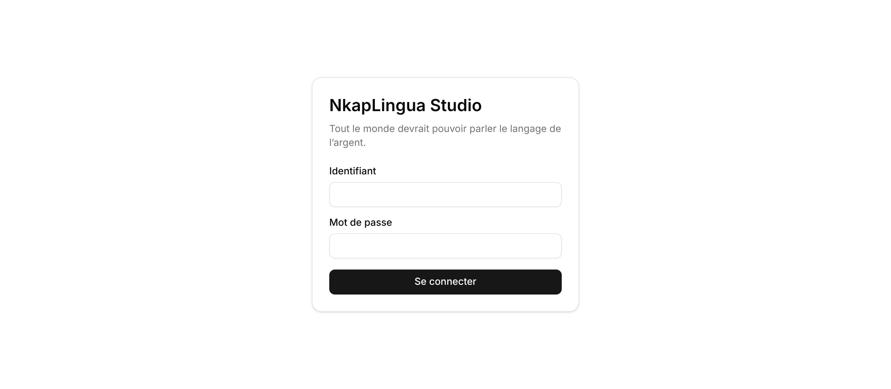
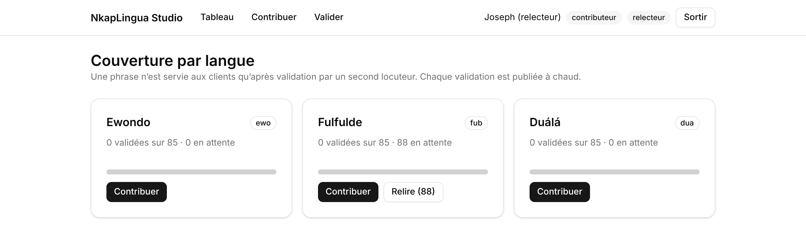
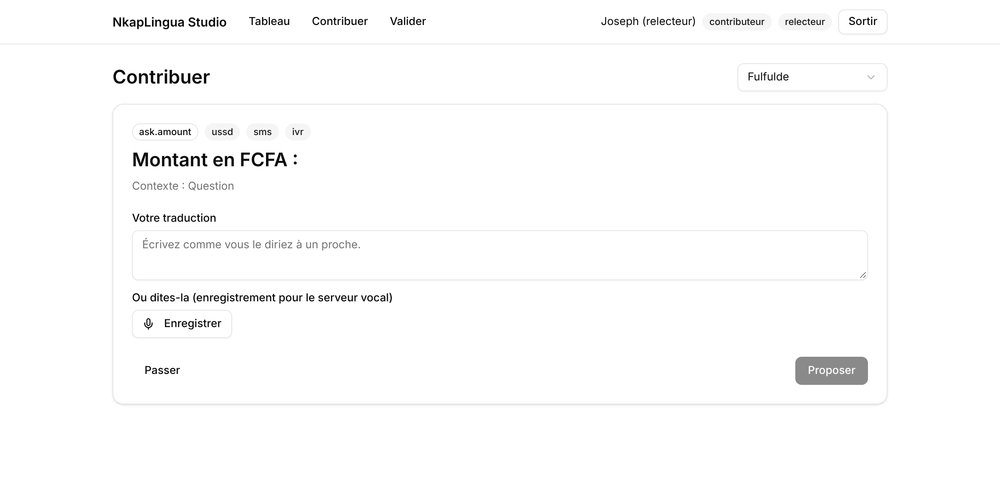
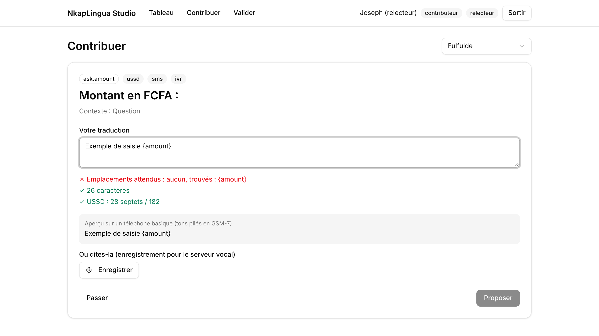
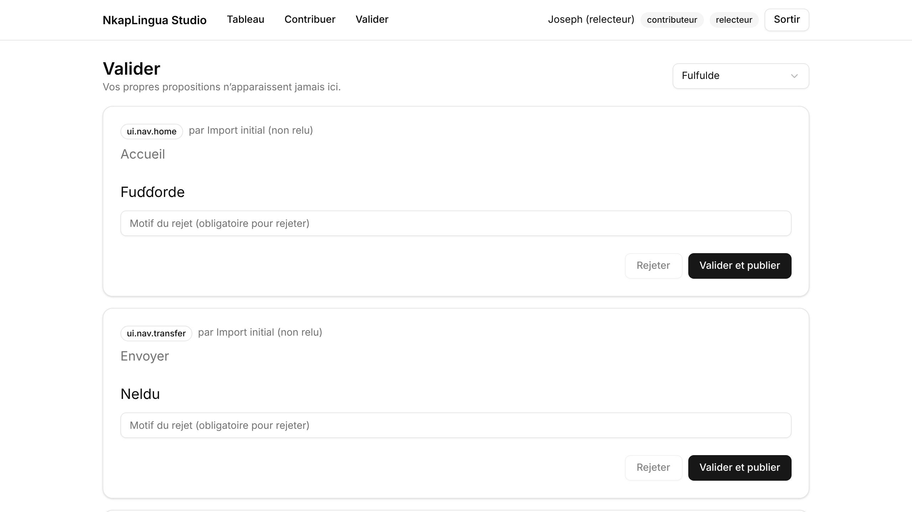

# NkapLingua Studio : l'interface web

> Tout le monde devrait pouvoir parler le langage de l'argent.

Le studio est l'atelier où les locuteurs apprennent aux services financiers à parler leur langue. Next.js 15, shadcn/ui, rendu serveur, aucune donnée sensible dans le navigateur.

## Rôles

| Rôle | Peut |
| --- | --- |
| Contributeur | proposer une traduction écrite ou orale dans ses langues |
| Relecteur | tout ce que fait le contributeur, et valider ou rejeter les propositions des **autres** |
| Admin | tout, sur toutes les langues |

Chaque compte est rattaché à une liste de langues. Le rôle est relu en base à chaque requête : un retrait de droit prend effet immédiatement.

## Connexion

Identifiant et mot de passe (empreinte scrypt). La session est un jeton signé, stocké dans un cookie httpOnly valable 8 heures. Sans session valide, toute page renvoie ici.

## Tableau

Une carte par langue du compte :

- nombre de phrases validées sur le total des phrases de référence ;
- nombre de propositions en attente ;
- barre de progression ;
- accès direct à « Contribuer » et, pour un relecteur, à « Relire (n) ».

## Contribuer

1. **La phrase de référence**, en français, avec sa clé, ses canaux (ussd, sms, ivr, mobile...) et sa longueur maximale.
2. **Le contexte** : où et comment la phrase apparaît (bouton, titre, question...).
3. **La traduction**, écrite comme on la dirait à un proche.
4. **L'enregistrement** au micro (30 s au plus, la durée d'un tour vocal), réécoutable avant envoi.
5. **Passer** si la phrase ne vous inspire pas, **Proposer** sinon.

### Contrôles en direct

Pendant la saisie, le studio vérifie :

- les **emplacements** (`{amount}`, `{name}`...) attendus et trouvés ;
- la **longueur** par rapport au maximum de l'écran ;
- le **budget USSD** en septets sur 182 ;
- une traduction **identique au français**, signalée.

L'**aperçu téléphone basique** montre la phrase exactement comme elle s'affichera sur un écran USSD, tons pliés en GSM-7. Le bouton « Proposer » reste grisé tant qu'un contrôle bloque ; le serveur refait les mêmes contrôles avec la même fonction.

## Valider

- La file ne montre **jamais** les propositions de l'utilisateur connecté.
- Pour chaque proposition : la clé, l'auteur, la phrase de référence, la proposition, l'écoute de la voix et la version publiée actuelle s'il y en a une.
- Une proposition uniquement orale demande une transcription avant validation.
- **Rejeter** exige un motif, pour que le contributeur progresse.
- **Valider et publier** écrit la base définitive puis diffuse la phrase : elle est servie par tous les middlewares en 1,8 ms (médiane), sans redémarrage. Une voix validée est convertie en mp3 et devient disponible pour le serveur vocal.

## Sécurité de l'interface

- Barrière de session sur toutes les pages, rôles revérifiés côté serveur pour chaque action.
- Règle des quatre yeux inscrite dans la requête de base de données.
- En-têtes : `X-Frame-Options: DENY`, `nosniff`, `Referrer-Policy: no-referrer`, micro autorisé seulement pour le studio.
- Audio des propositions accessible aux seuls relecteurs connectés.
